# KA Check (kiro-atelier-check)

**KA Check** tells whether a PC can run **Kiro Atelier** (KA), before anyone gets it. It is free, installs and
changes nothing, and gives one plain verdict: "This PC can run Kiro Atelier" or "This PC can't run Kiro Atelier",
with the reason per check and what the user can do about it.


*One photo, painted by Kiro Atelier on a home PC in five of its styles. KA Check shows every style on four photos
before you decide. Photo: Stanton Mountain, Lake McDonald (public domain).*

**Kiro Atelier** turns your photos and wallpapers into paintings on your own computer, with no cloud and no account:
impasto, watercolour, gouache, pastel, Japanese woodblock, linocut, charcoal and more, in 4K.
Get it here: [Kiro Atelier](https://ko-fi.com/s/6ff5175237), after KA Check says your PC can run it.

## Videos

1. **Start here — KA Check**: run it first to see whether your PC can run Kiro Atelier.
   [Watch on YouTube](https://youtu.be/Igz7gAPWQNA)
2. **Kiro Atelier at work — an example**: [Watch on YouTube](https://youtu.be/yeytaYsZgQY)

## What it checks

| Check | Needed |
|---|---|
| Linux system | Arch-based (pacman): Kiro, KiroTux, Arch |
| Graphics card | NVIDIA (Intel and AMD are not supported) |
| NVIDIA driver | working (`nvidia-smi`) |
| Card generation | Turing or newer (RTX 20xx / GTX 16xx, compute 7.5) |
| Video memory | 6 GB |
| Memory (RAM) | 16 GB (12–15 GB gives a warning) |
| Free disk space | about 20 GB in the home folder |

Hard failures carry a "More info" with the technical reason. When the card is the problem, "What you can do"
explains how another Arch-based Linux PC in the home can do the painting ("Another computer" mode).

## Which graphics cards work?

The same list KA Check shows behind its "Which graphics cards work?" button (`kiro-atelier-check --cards`).

### ✔ Meets the requirements

| Family | Type | Cards |
|---|---|---|
| GeForce RTX 20 | Desktop | RTX 2060, 2060 12GB, 2060 Super, 2070, 2070 Super, 2080, 2080 Super, 2080 Ti, Titan RTX |
| GeForce RTX 20 | Laptop | RTX 2060, 2070, 2070 Super, 2080, 2080 Super (+ Max-Q) |
| GeForce RTX 30 | Desktop | RTX 3050 6GB, 3050 8GB, 3060, 3060 Ti, 3070, 3070 Ti, 3080, 3080 Ti, 3090, 3090 Ti |
| GeForce RTX 30 | Laptop | RTX 3050 6GB, 3060, 3070, 3070 Ti, 3080, 3080 Ti |
| GeForce RTX 40 | Desktop | RTX 4060, 4060 Ti, 4070, 4070 Super, 4070 Ti, 4070 Ti Super, 4080, 4080 Super, 4090 |
| GeForce RTX 40 | Laptop | RTX 4050, 4060, 4070, 4080, 4090 |
| GeForce RTX 50 | Desktop | RTX 5050, 5060, 5060 Ti, 5070, 5070 Ti, 5080, 5090 |
| GeForce RTX 50 | Laptop | RTX 5050, 5060, 5070, 5070 Ti, 5080, 5090 |
| Workstation | Desktop | Quadro RTX 4000, 5000, 6000, 8000 · RTX A1000, A2000, A4000, A4500, A5000, A5500, A6000 · RTX 2000 Ada, 4000 SFF Ada, 4000 Ada, 4500 Ada, 5000 Ada, 6000 Ada · RTX PRO 2000, 4000, 4000 SFF, 4500, 5000, 6000 Blackwell |
| Workstation | Laptop | Quadro RTX 3000, 4000, 5000, 6000 · RTX A1000 6GB, A2000 8GB, A3000, A4000, A4500, A5000, A5500 · RTX 1000 Ada, 2000 Ada, 3000 Ada, 3500 Ada, 4000 Ada, 5000 Ada · RTX PRO 500, 1000, 2000, 3000, 4000, 5000 Blackwell |

### ! Meets the requirements, but likely slow (not tested)

| Family | Type | Cards |
|---|---|---|
| GeForce GTX 16 | Desktop | GTX 1660, 1660 Super, 1660 Ti |
| GeForce GTX 16 | Laptop | GTX 1660 Ti |
| Workstation | Desktop | T1000 8GB |

### ✘ Doesn't work

| Reason | | Cards |
|---|---|---|
| Less than 6 GB | of video memory | GTX 1630, 1650 (all versions) · RTX 2050 · RTX 3050 4GB, 3050 Ti and 3050 A (laptop) · MX series · T400, T500, T550, T600, T1000 4GB, T1200, T2000 · RTX A400, A500, A1000 4GB (laptop), A2000 4GB (laptop) · RTX 500 Ada |
| Too old | before the RTX 20 / GTX 16 generation | GTX 10xx and older (1080 Ti, 1070, 1060 …) · Titan X, Titan Xp, Titan V · Quadro P and M series, Quadro GV100 |
| Not NVIDIA | | AMD Radeon, Intel Arc, graphics built into the processor |

Tested on an RTX 2060 (6 GB); the other cards meet the same requirements but haven't been tried. Laptop and
workstation cards with the same name can have different amounts of video memory, and a laptop card paints slower
than the desktop card with the same name. KA Check on the PC itself has the last word.

## All 22 styles

Every Kiro Atelier style on the same four photos, the gallery KA Check shows before you decide. Click a picture for the full size. Photos: public domain / CC0.

### The four photos

<a href="usr/share/kiro-atelier-check/gallery/view/original-mountain-lake.jpg">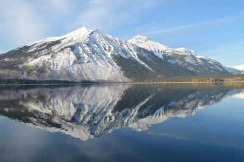</a> <a href="usr/share/kiro-atelier-check/gallery/view/original-city.jpg">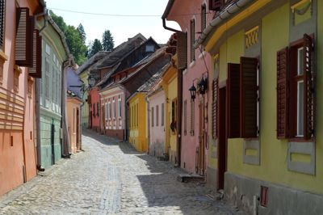</a> <a href="usr/share/kiro-atelier-check/gallery/view/original-portrait.jpg">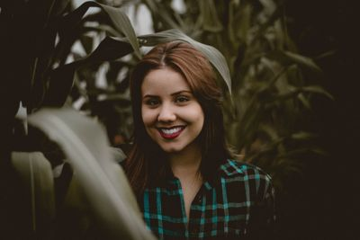</a> <a href="usr/share/kiro-atelier-check/gallery/view/original-sea.jpg">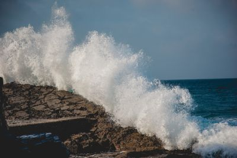</a>

### Default

The original Kiro Atelier look: thick impasto, a good balance between photo and paint.  
*strength 0.65 · impasto · 3840 × 2160*

<a href="usr/share/kiro-atelier-check/gallery/view/default-mountain-lake.jpg">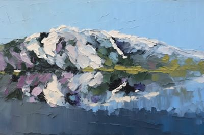</a> <a href="usr/share/kiro-atelier-check/gallery/view/default-city.jpg">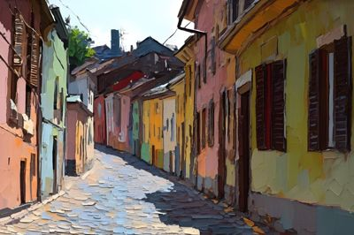</a> <a href="usr/share/kiro-atelier-check/gallery/view/default-portrait.jpg">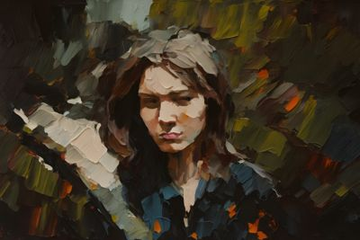</a> <a href="usr/share/kiro-atelier-check/gallery/view/default-sea.jpg">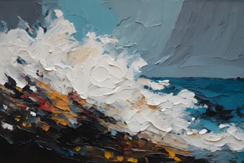</a>

### Palette Knife

Loose, heavy impasto with real knife ridges; the photo shows through less. Twice as slow.  
*strength 0.75 · impasto · 3840 × 2160 · detail pass*

<a href="usr/share/kiro-atelier-check/gallery/view/palette-knife-mountain-lake.jpg">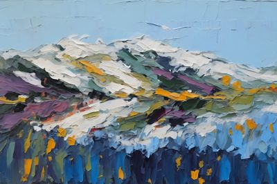</a> <a href="usr/share/kiro-atelier-check/gallery/view/palette-knife-city.jpg">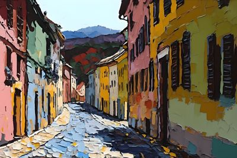</a> <a href="usr/share/kiro-atelier-check/gallery/view/palette-knife-portrait.jpg">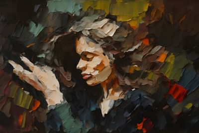</a> <a href="usr/share/kiro-atelier-check/gallery/view/palette-knife-sea.jpg">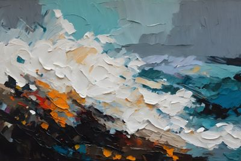</a>

### Gentle Touch

Stays close to the photo: same shapes and light, with a soft layer of paint over it.  
*strength 0.45 · impasto · 3840 × 2160*

<a href="usr/share/kiro-atelier-check/gallery/view/gentle-touch-mountain-lake.jpg">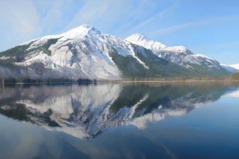</a> <a href="usr/share/kiro-atelier-check/gallery/view/gentle-touch-city.jpg">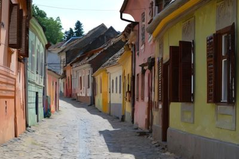</a> <a href="usr/share/kiro-atelier-check/gallery/view/gentle-touch-portrait.jpg"></a> <a href="usr/share/kiro-atelier-check/gallery/view/gentle-touch-sea.jpg"></a>

### Gallery Print

Best quality for printing or a big screen: extra detail pass, saved as PNG. Slow, large files.  
*strength 0.55 · impasto · 3840 × 2160 · detail pass*

<a href="usr/share/kiro-atelier-check/gallery/view/gallery-print-mountain-lake.jpg">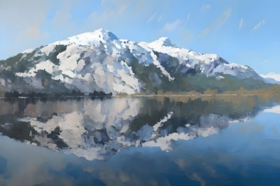</a> <a href="usr/share/kiro-atelier-check/gallery/view/gallery-print-city.jpg">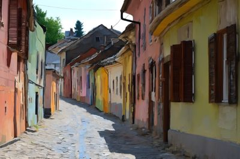</a> <a href="usr/share/kiro-atelier-check/gallery/view/gallery-print-portrait.jpg">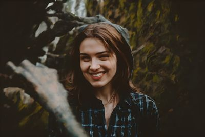</a> <a href="usr/share/kiro-atelier-check/gallery/view/gallery-print-sea.jpg">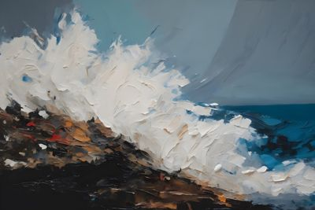</a>

### Morning Wash

Soft watercolour: light washes, gentle edges, paper texture.  
*strength 0.60 · watercolour · 3840 × 2160*

<a href="usr/share/kiro-atelier-check/gallery/view/morning-wash-mountain-lake.jpg">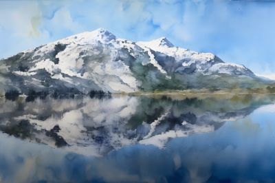</a> <a href="usr/share/kiro-atelier-check/gallery/view/morning-wash-city.jpg"></a> <a href="usr/share/kiro-atelier-check/gallery/view/morning-wash-portrait.jpg">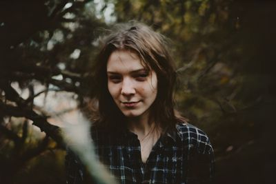</a> <a href="usr/share/kiro-atelier-check/gallery/view/morning-wash-sea.jpg">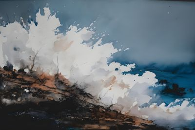</a>

### Monsoon

Wild watercolour: colours run and bleed into each other, far from the photo.  
*strength 0.75 · watercolour · 3840 × 2160*

<a href="usr/share/kiro-atelier-check/gallery/view/monsoon-mountain-lake.jpg">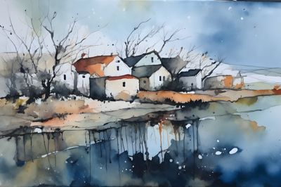</a> <a href="usr/share/kiro-atelier-check/gallery/view/monsoon-city.jpg">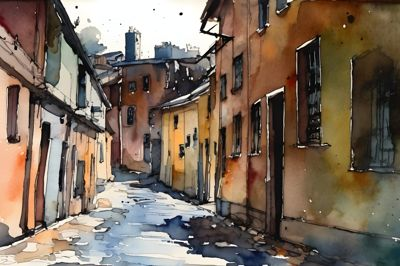</a> <a href="usr/share/kiro-atelier-check/gallery/view/monsoon-portrait.jpg">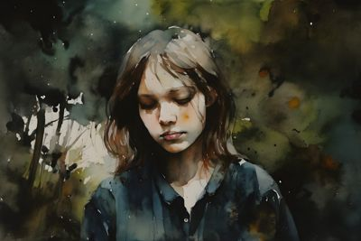</a> <a href="usr/share/kiro-atelier-check/gallery/view/monsoon-sea.jpg">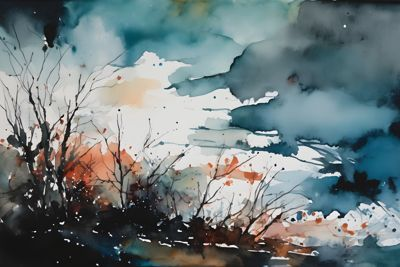</a>

### Poster Studio

Gouache: flat, bold colour shapes like a travel poster.  
*strength 0.70 · gouache · 3840 × 2160*

<a href="usr/share/kiro-atelier-check/gallery/view/poster-studio-mountain-lake.jpg">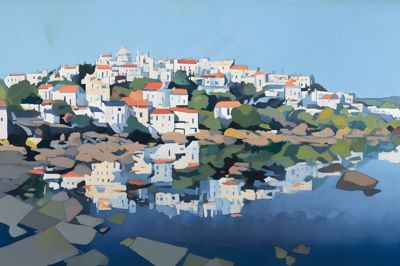</a> <a href="usr/share/kiro-atelier-check/gallery/view/poster-studio-city.jpg">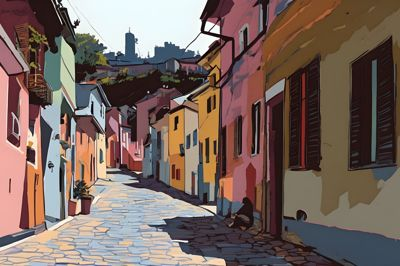</a> <a href="usr/share/kiro-atelier-check/gallery/view/poster-studio-portrait.jpg">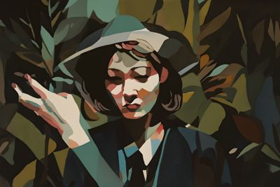</a> <a href="usr/share/kiro-atelier-check/gallery/view/poster-studio-sea.jpg">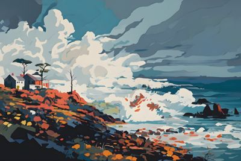</a>

### Pastel Light

Soft pastel: chalky strokes and blended light on toned paper.  
*strength 0.60 · pastel · 3840 × 2160*

<a href="usr/share/kiro-atelier-check/gallery/view/pastel-light-mountain-lake.jpg">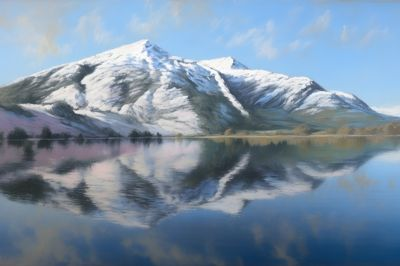</a> <a href="usr/share/kiro-atelier-check/gallery/view/pastel-light-city.jpg">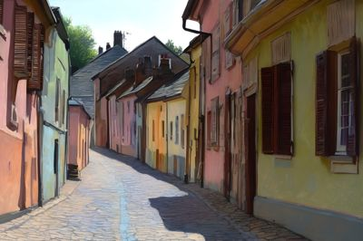</a> <a href="usr/share/kiro-atelier-check/gallery/view/pastel-light-portrait.jpg">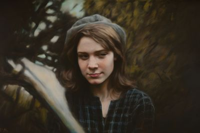</a> <a href="usr/share/kiro-atelier-check/gallery/view/pastel-light-sea.jpg">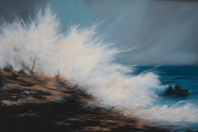</a>

### Floating World

Japanese woodblock print: clean outlines, flat colours, patterned waves and clouds. Scenes and poses stay; faces take on the woodblock look.  
*strength 0.55 · ukiyo-e · 3840 × 2160*

<a href="usr/share/kiro-atelier-check/gallery/view/floating-world-mountain-lake.jpg">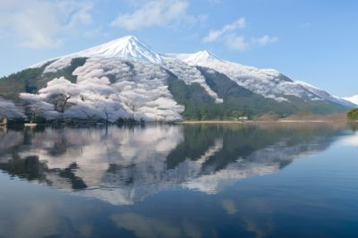</a> <a href="usr/share/kiro-atelier-check/gallery/view/floating-world-city.jpg">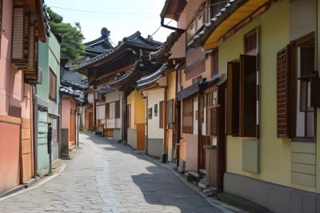</a> <a href="usr/share/kiro-atelier-check/gallery/view/floating-world-portrait.jpg">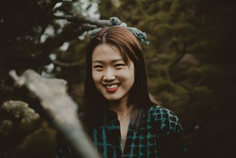</a> <a href="usr/share/kiro-atelier-check/gallery/view/floating-world-sea.jpg">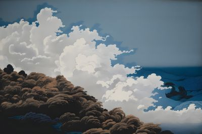</a>

### Edo Landscape

Strongest woodblock look, for landscapes. People and action scenes get replaced.  
*strength 0.65 · ukiyo-e · 3840 × 2160*

<a href="usr/share/kiro-atelier-check/gallery/view/edo-landscape-mountain-lake.jpg">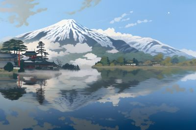</a> <a href="usr/share/kiro-atelier-check/gallery/view/edo-landscape-city.jpg">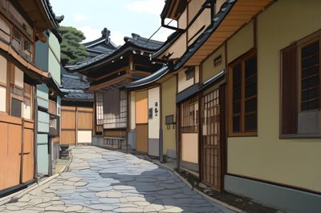</a> <a href="usr/share/kiro-atelier-check/gallery/view/edo-landscape-portrait.jpg">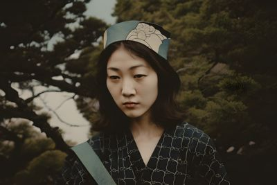</a> <a href="usr/share/kiro-atelier-check/gallery/view/edo-landscape-sea.jpg">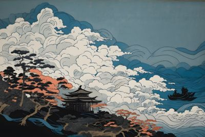</a>

### Linocut

Woodcut print: bold carved black lines and a few flat colours. Best on landscapes.  
*strength 0.70 · woodcut · 3840 × 2160*

<a href="usr/share/kiro-atelier-check/gallery/view/linocut-mountain-lake.jpg">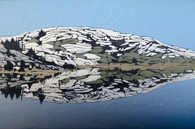</a> <a href="usr/share/kiro-atelier-check/gallery/view/linocut-city.jpg">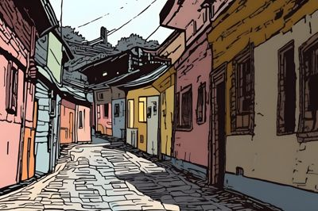</a> <a href="usr/share/kiro-atelier-check/gallery/view/linocut-portrait.jpg">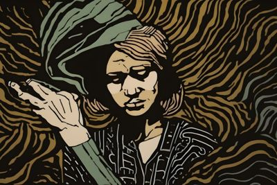</a> <a href="usr/share/kiro-atelier-check/gallery/view/linocut-sea.jpg">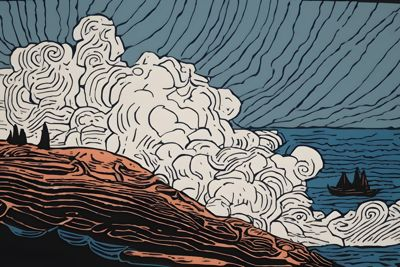</a>

### Charcoal Sketch

Charcoal drawing: smudged black and grey strokes on rough paper, strong contrast.  
*strength 0.65 · charcoal · 3840 × 2160*

<a href="usr/share/kiro-atelier-check/gallery/view/charcoal-sketch-mountain-lake.jpg">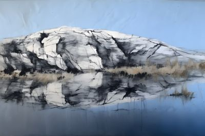</a> <a href="usr/share/kiro-atelier-check/gallery/view/charcoal-sketch-city.jpg">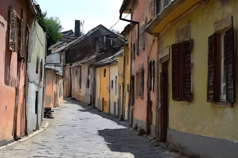</a> <a href="usr/share/kiro-atelier-check/gallery/view/charcoal-sketch-portrait.jpg">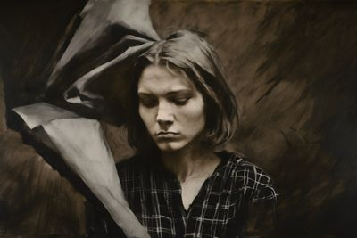</a> <a href="usr/share/kiro-atelier-check/gallery/view/charcoal-sketch-sea.jpg">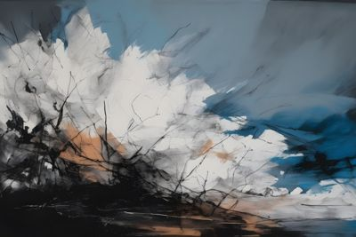</a>

### Expressionist

Raw, emotional brushwork in bold, unusual colours. Shapes stay, colours go wild.  
*strength 0.70 · expressionist · 3840 × 2160*

<a href="usr/share/kiro-atelier-check/gallery/view/expressionist-mountain-lake.jpg">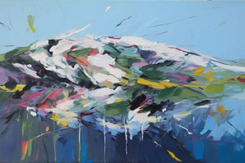</a> <a href="usr/share/kiro-atelier-check/gallery/view/expressionist-city.jpg"></a> <a href="usr/share/kiro-atelier-check/gallery/view/expressionist-portrait.jpg"></a> <a href="usr/share/kiro-atelier-check/gallery/view/expressionist-sea.jpg"></a>

### Psychedelic

Swirling patterns and vibrant colour, far from the photo.  
*strength 0.75 · psychedelic · 3840 × 2160*

<a href="usr/share/kiro-atelier-check/gallery/view/psychedelic-mountain-lake.jpg"></a> <a href="usr/share/kiro-atelier-check/gallery/view/psychedelic-city.jpg"></a> <a href="usr/share/kiro-atelier-check/gallery/view/psychedelic-portrait.jpg"></a> <a href="usr/share/kiro-atelier-check/gallery/view/psychedelic-sea.jpg"></a>

### Renaissance

Old-master oil on panel. Reimagines the scene: expect new buildings and people.  
*strength 0.70 · renaissance · 3840 × 2160*

<a href="usr/share/kiro-atelier-check/gallery/view/renaissance-mountain-lake.jpg"></a> <a href="usr/share/kiro-atelier-check/gallery/view/renaissance-city.jpg"></a> <a href="usr/share/kiro-atelier-check/gallery/view/renaissance-portrait.jpg"></a> <a href="usr/share/kiro-atelier-check/gallery/view/renaissance-sea.jpg"></a>

### Dreamscape

Surrealist dream: strange objects appear where you don't expect them.  
*strength 0.70 · surrealist · 3840 × 2160*

<a href="usr/share/kiro-atelier-check/gallery/view/dreamscape-mountain-lake.jpg"></a> <a href="usr/share/kiro-atelier-check/gallery/view/dreamscape-city.jpg"></a> <a href="usr/share/kiro-atelier-check/gallery/view/dreamscape-portrait.jpg"></a> <a href="usr/share/kiro-atelier-check/gallery/view/dreamscape-sea.jpg"></a>

### Art Deco

Geometric shapes, gold accents and bold colour. Reimagines the scene.  
*strength 0.70 · art-deco · 3840 × 2160*

<a href="usr/share/kiro-atelier-check/gallery/view/art-deco-mountain-lake.jpg"></a> <a href="usr/share/kiro-atelier-check/gallery/view/art-deco-city.jpg"></a> <a href="usr/share/kiro-atelier-check/gallery/view/art-deco-portrait.jpg"></a> <a href="usr/share/kiro-atelier-check/gallery/view/art-deco-sea.jpg"></a>

### Layered Paper

Stacked papercut: cut paper layers with depth and strong contrast.  
*strength 0.70 · stacked-papercut · 3840 × 2160*

<a href="usr/share/kiro-atelier-check/gallery/view/layered-paper-mountain-lake.jpg"></a> <a href="usr/share/kiro-atelier-check/gallery/view/layered-paper-city.jpg"></a> <a href="usr/share/kiro-atelier-check/gallery/view/layered-paper-portrait.jpg"></a> <a href="usr/share/kiro-atelier-check/gallery/view/layered-paper-sea.jpg"></a>

### Shadow Box

Layered paper silhouettes lit from behind. Adds trees, moons and figures of its own.  
*strength 0.75 · shadow-box · 3840 × 2160*

<a href="usr/share/kiro-atelier-check/gallery/view/shadow-box-mountain-lake.jpg"></a> <a href="usr/share/kiro-atelier-check/gallery/view/shadow-box-city.jpg"></a> <a href="usr/share/kiro-atelier-check/gallery/view/shadow-box-portrait.jpg"></a> <a href="usr/share/kiro-atelier-check/gallery/view/shadow-box-sea.jpg"></a>

### Paper Quilling

Curled paper strips, coils and loops. Landscapes keep their shape; animals turn into ornaments.  
*strength 0.70 · paper-quilling · 3840 × 2160*

<a href="usr/share/kiro-atelier-check/gallery/view/paper-quilling-mountain-lake.jpg"></a> <a href="usr/share/kiro-atelier-check/gallery/view/paper-quilling-city.jpg"></a> <a href="usr/share/kiro-atelier-check/gallery/view/paper-quilling-portrait.jpg"></a> <a href="usr/share/kiro-atelier-check/gallery/view/paper-quilling-sea.jpg"></a>

### Origami

Folded paper: crisp facets and pleats. Animals and buildings become paper models.  
*strength 0.65 · origami · 3840 × 2160*

<a href="usr/share/kiro-atelier-check/gallery/view/origami-mountain-lake.jpg"></a> <a href="usr/share/kiro-atelier-check/gallery/view/origami-city.jpg"></a> <a href="usr/share/kiro-atelier-check/gallery/view/origami-portrait.jpg"></a> <a href="usr/share/kiro-atelier-check/gallery/view/origami-sea.jpg"></a>

### Light Files

Impasto at 1920 × 1080: small files for a laptop or a second screen. Paints as fast as 4K.  
*strength 0.60 · impasto · 1920 × 1080*

<a href="usr/share/kiro-atelier-check/gallery/view/light-files-mountain-lake.jpg"></a> <a href="usr/share/kiro-atelier-check/gallery/view/light-files-city.jpg"></a> <a href="usr/share/kiro-atelier-check/gallery/view/light-files-portrait.jpg"></a> <a href="usr/share/kiro-atelier-check/gallery/view/light-files-sea.jpg"></a>

## What it ships

- `/usr/bin/kiro-atelier-check` — the whole tool, one standalone Python file (no Kiro Atelier imports)
- `/usr/share/applications/kiro-atelier-check.desktop` — menu entry "KA Check"
- `/usr/share/icons/hicolor/{scalable,256x256}/apps/kiro-atelier-check.*` — KA's brush with a green check

## How to install and run

On Kiro and KiroTux it comes from `nemesis_repo`. On other Arch-based systems, download the package for free from
[KA Check on Ko-fi](https://ko-fi.com/s/313e890205) and install the file.

```
sudo pacman -S kiro-atelier-check                        # Kiro, KiroTux
sudo pacman -U kiro-atelier-check-*.pkg.tar.zst          # other Arch-based systems
kiro-atelier-check            # window (GTK 4); falls back to the terminal without a desktop
kiro-atelier-check --text     # terminal report; add --more for the technical reasons
```

The file also runs on its own (`python3 kiro-atelier-check`), which is how it can be offered as a single
download. Exit code: 0 = can run, 1 = can't, 2 = can run with a warning.

## Languages

English, Dutch, German, Spanish, French, Brazilian Portuguese, Russian, Hungarian, Italian, Turkish, Polish,
Japanese, Simplified Chinese and Romanian: KA Check follows the system language, and the dropdown at the top right
picks another one. Catalogs live in `po/`; `bash po/make-mo.sh` extracts, merges and compiles them.
